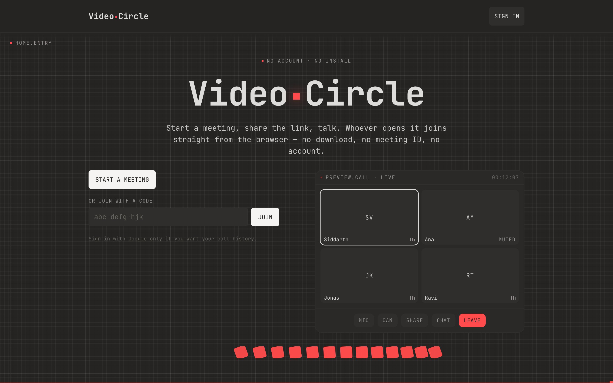
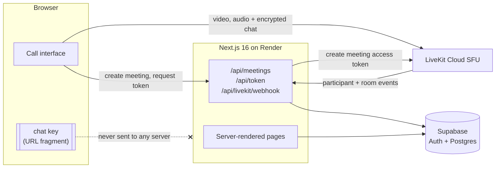
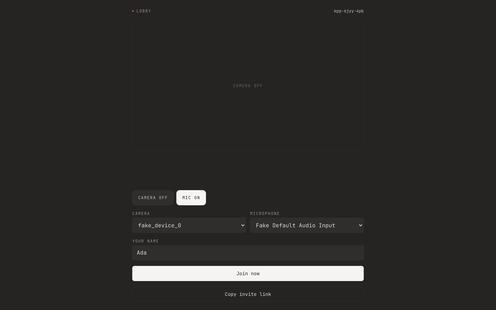
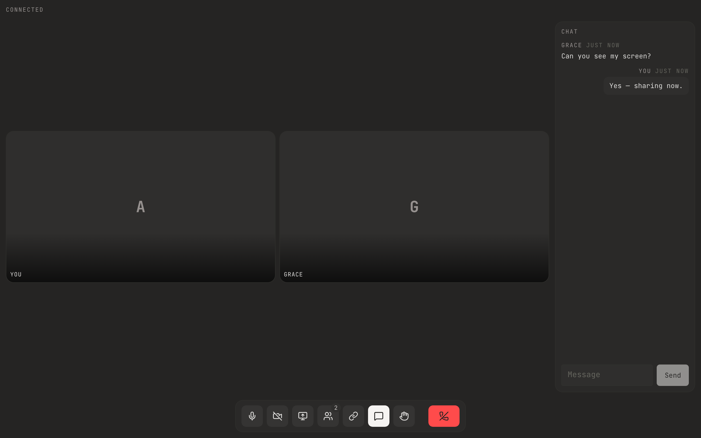
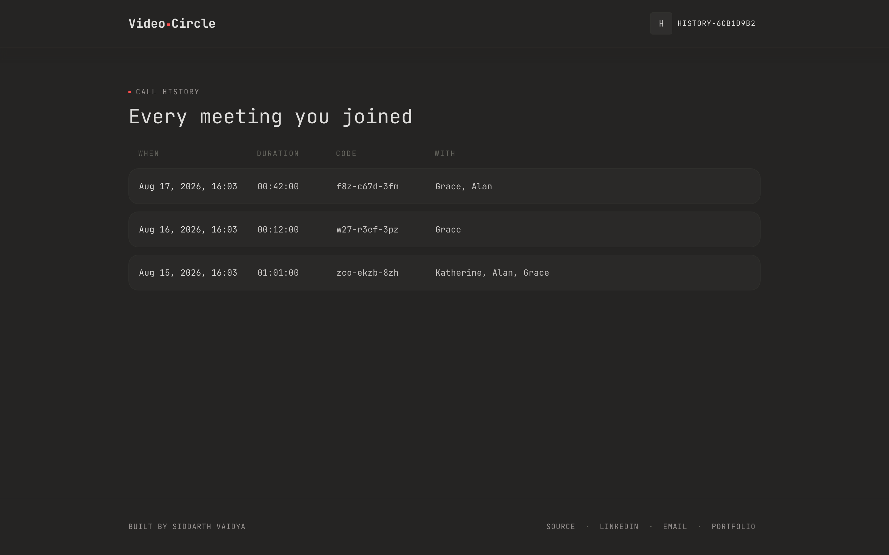

# VideoCircle

[](https://videocircle-blw4.onrender.com)
[](https://github.com/SidVaidya2005/VideoCircle/actions/workflows/github-code-scanning/codeql)
[](https://repowise.dev/repo/sidvaidya2005/videocircle)
[](https://repowise.dev/repo/sidvaidya2005/videocircle)
[](LICENSE)
[](https://www.typescriptlang.org/)
[](https://nextjs.org/)
[](https://livekit.io/)

Make video calls in your browser. Start a meeting and share the link. Guests can
check their camera and microphone before joining, with no account or download.
Google sign-in is optional and adds call history.

Chat messages are end-to-end encrypted: participants with the full meeting link
can read them, while the server only forwards encrypted data. Video and audio are
encrypted during transmission, but they are not end-to-end encrypted. See
[Security](#security) for the details.



## Contents

[Demo](#demo) · [Features](#features) · [How it works](#how-it-works) ·
[Architecture](#architecture) · [Security](#security) ·
[Screenshots](#screenshots) · [Stack](#stack) ·
[Project structure](#project-structure) · [Getting started](#getting-started) ·
[Non-goals](#non-goals) · [Status](#status) · [Documentation](#documentation) ·
[Licence](#licence)

## Demo

**[videocircle-blw4.onrender.com](https://videocircle-blw4.onrender.com)**

Render's free hosting pauses the demo after 15 minutes without traffic. Your next
visit may show Render's loading page for about a minute while the app restarts.

## Features

- Join as a guest, or sign in with Google to save your call history
- Share meeting links with randomly generated codes that are difficult to guess
- Preview your camera, enter a display name, and set your mic and camera before joining
- Choose your camera, microphone, and speaker before or during a call
- Make video and audio calls with up to about 12 people
- See a grid that adjusts as people join, or pin one person in a larger view
- Share your screen in a larger view
- Send end-to-end encrypted chat messages
- See who has their mic or camera on in the participant list
- Send reactions or raise your hand
- View past calls: when they happened, how long you stayed, and who else joined
- Use `d` to toggle your mic and `e` to toggle your camera, except while typing
- See connection quality and reconnect automatically after an interruption
- Use the app on phones, with layouts down to 360px wide and touch targets at least 44px across

## How it works

### The link is the key

When you create a meeting, your browser generates an encryption key and adds it
after the `#` in the link: `/room/abc-defg-hjk#k=<key>`. This part of a URL is called
the **fragment**. Browsers don't include it in requests to the server, and the app
keeps the key in the browser.

Your browser encrypts messages before sending them through LiveKit, the service
that carries the call. Other participants' browsers decrypt them using the same
key. Messages stay in browser memory, so reloading the page clears your chat
history. Opening a link without the key shows a notice explaining that chat is
unavailable.

During Google sign-in, the app temporarily keeps the fragment in `sessionStorage`,
the browser's storage for that tab, and restores it when you return.

### Joining takes no setup

A guest enters a name in the lobby and joins. Each join gets a new internal
participant ID, which isn't reused across meetings.

Google sign-in returns you to the page where you started.

### Real-time media

LiveKit routes video, audio, and screen sharing between participants. Its server
is called an **SFU**, short for selective forwarding unit.

Your browser requests an **access token**, permission to join one meeting for at
most an hour, limited by the meeting's expiry. It allows sending and receiving
media and data, and updating your own participant details. It grants no room
administration permissions. Missing, ended, or expired meetings can't issue tokens.

Call history comes from **webhooks**, event notifications that LiveKit sends when
someone joins, leaves, or the room empties. The app verifies each notification and
records the times supplied by LiveKit.

### How it was tested

The tests cover individual functions and full browser flows, including joining,
calls, chat, and call history. Features involving two people use two separate
browser sessions.

I checked the tests by deliberately breaking the expected behavior. One useful
discovery: looking for `Connected` also matched `Disconnected`, letting tests
continue before the call connected. Fixing that check resolved two unreliable
tests.

More examples are in
[`docs/ENGINEERING-NOTES.md`](docs/ENGINEERING-NOTES.md).

## Architecture



The browser handles the interface and chat encryption. Next.js handles meeting
creation, access tokens, and event notifications. LiveKit carries the call, while
Supabase provides Google sign-in and a Postgres database for meetings, profiles,
and participation records.

**Row-level security (RLS)** controls which database records each user can access.
Secret credentials stay in modules marked `server-only`, keeping those modules
out of browser components. See
[`context/architecture.md`](context/architecture.md) for the full implementation.

## Security

### What is end-to-end encrypted, and what isn't

**Chat is end-to-end encrypted.** AES-GCM encryption uses a 256-bit key and detects
message tampering. Each message gets a fresh random 12-byte initialization vector
(IV), a value that mustn't be reused with the same key. An integrity check includes
the sender's participant ID, so forwarding an encrypted message under another ID
fails the check.

**Video and audio are encrypted in transit, but not end-to-end.** They use the
WebRTC transport protections DTLS/SRTP. LiveKit's media server can decrypt them;
this app does not enable end-to-end encryption for video, audio, or screen sharing.

### The link works like a password

Anyone with the full link can join an open meeting and read its chat. The lobby
lets you check your devices; it doesn't require host approval. Share the link only
with people you want in the call. Changing the chat key requires sharing a new
link.

Room codes use 10 randomly selected characters from a 32-character alphabet,
giving about **1.1 quadrillion possible codes** (50 bits of randomness). Look-alike
characters are excluded to make codes easier to read. A code still needs to match
an existing, open meeting before the server grants access.

### What the server can see

The app server stores meeting codes and creator details. Participation records
contain display names, join and leave times, and internal participant IDs. The
chat key and readable message contents are not sent to it. LiveKit forwards the
encrypted chat data.

### Boundaries

- The privileged database key, which bypasses access rules, is kept in a server-only module.
- LiveKit notifications are checked for a valid signature and an unchanged request body.
- Google is the only sign-in method. Supabase's email/password provider is disabled
  to prevent account creation through that alternative route.
- Guest participation records remain for as long as the meeting record, so guests
  appear in other participants' call history. Each guest ID is used for one join only.

GitHub's CodeQL scanner checks the repository for potential security issues.

## Screenshots

**The lobby.** Preview your camera, choose your devices, and set your mic and camera
before joining.



**In a call.** Participant tiles, call controls, and the encrypted chat panel.



**Call history.** Signed-in users can see past meetings, their duration, meeting
codes, and the other participants.



The screenshots use simulated camera and microphone devices for testing, so they
show camera-off placeholders and test device names.

## Stack

- **Interface:** TypeScript, Next.js 16, React 19, Tailwind CSS 4, and shadcn/ui
- **Calls:** LiveKit Cloud
- **Sign-in and database:** Supabase Auth and Postgres
- **Data validation:** Zod
- **Testing:** Vitest for individual functions and Playwright for browser flows
- **Hosting:** Render

## Project structure

Application code lives in `src/`, automated tests in `tests/`, and database changes
in `supabase/migrations/`.

```
src/
├── proxy.ts                  Refreshes the Supabase session on every request
├── app/
│   ├── (shell)/              Home and /history, the pages with the site header
│   ├── room/[code]/          One route: the lobby until you join, then the call
│   ├── api/                  Create meetings, grant access, receive LiveKit events
│   ├── auth/                 Return from Google sign-in and sign out
│   └── healthz/              Endpoint that tells Render the app is running
├── components/
│   ├── room/                 The call: grid, tiles, control bar, spotlight, invite
│   ├── lobby/                Self-preview, device pickers, joining
│   ├── chat/                 The encrypted chat panel
│   ├── history/, home/       Page-specific pieces
│   ├── shell/                Header, footer, account menu
│   └── ui/                   Shared interface components from shadcn/ui
├── hooks/                    Media preview and devices, chat key, encrypted chat,
│                             raise hand, call shortcuts, media queries
├── lib/
│   ├── crypto/               Chat key and message encryption (all AES-GCM code)
│   ├── livekit/              Access tokens, expiry limits, event verification
│   ├── supabase/             Server, browser, and admin clients
│   ├── media/                Device preferences and error classification
│   └── *.ts                  Room codes, invite links, grid layout, history
└── types/                    Generated database types

tests/
├── unit/                     Vitest: crypto, room codes, formatting, pure logic
├── e2e/                      Playwright: lobby, join, calls, chat, webhooks
└── support/                  Helpers shared by both
```

The full folder tree, database design, and implementation rules are in
[`context/architecture.md`](context/architecture.md).

## Getting started

To try the app, open the [demo](#demo). The steps below are for running your own
copy on your computer. You'll need Node.js and cloud service accounts, plus real
values for all seven configuration variables.

### Prerequisites

- Node.js 20.9 or later (Render uses Node.js 22 for builds)
- A [LiveKit Cloud](https://cloud.livekit.io) project (API key, secret, and `wss://` URL)
- A [Supabase](https://supabase.com) project with the Google provider enabled
- Google Cloud OAuth 2.0 credentials for Google sign-in, with Supabase's callback
  URL registered

### Environment

Copy `.env.example` to `.env.local` and fill in your service details. These
**environment variables** tell the app which services to connect to. Keep
`.env.local` out of Git because it contains secret credentials.

| Variable                        | Secret? | Notes                                               |
| ------------------------------- | ------- | --------------------------------------------------- |
| `NEXT_PUBLIC_SITE_URL`          | No      | Origin used for OAuth redirects and share links     |
| `NEXT_PUBLIC_SUPABASE_URL`      | No      | Your Supabase project URL                           |
| `NEXT_PUBLIC_SUPABASE_ANON_KEY` | No      | Public key used with database access rules          |
| `SUPABASE_SERVICE_ROLE_KEY`     | **Yes** | Privileged database key; server only                |
| `NEXT_PUBLIC_LIVEKIT_URL`       | No      | Your LiveKit connection URL, starting with `wss://` |
| `LIVEKIT_API_KEY`               | **Yes** | LiveKit API credential                              |
| `LIVEKIT_API_SECRET`            | **Yes** | Signs access tokens and verifies events             |

### Run it

```bash
npm install
npx supabase link --project-ref <your-project-ref>   # prompts for the DB password
npx supabase db push                                 # apply migrations
npm run dev                                          # http://localhost:3000
```

Run `link` before `db push`: it connects the local project to your Supabase project
and asks for your database password. Then `db push` applies the database changes.

Open `http://localhost:3000` after starting the server. Browsers allow the
encryption API on `localhost`, so local chat works without setting up HTTPS.

### Test it

```bash
npx playwright install chromium   # once per machine
npm run test       # Vitest: crypto, room codes, formatting
npm run test:e2e   # Playwright: lobby, join, two-person chat
npm run typecheck  # tsc --noEmit
npm run lint       # ESLint, Prettier, then the design-system and context-drift checks
```

Browser tests run on port 3100, separate from the usual development server on 3000. They use simulated cameras and microphones, but still need valid LiveKit
and Supabase credentials. See [Deployment](docs/DEPLOYMENT.md#before-every-deploy)
for running the suite against a production build.

### Deploy it

[The deployment guide](docs/DEPLOYMENT.md) explains how to put your copy online
with Render and which checks to run before and after deployment.

## Non-goals

I kept the scope focused on joining a call by link. These features are outside the
current scope:

- **Recording**, cloud or local, and playback
- **End-to-end encrypted video, audio, and screen sharing** (see [Security](#security))
- **Saved chat transcripts**; messages stay in browser memory and aren't saved by the app
- **Waiting rooms, host admission, and moderation** (muting or removing people)
- **Virtual backgrounds and background blur**
- **Live transcription, captions, and translation**
- **Breakout rooms**
- **Scheduled meetings, calendar integration, and permanent personal rooms**
- **Native iOS and Android apps**, and dial-in by phone
- **File sharing, whiteboard, and polls**
- **Teams, organizations, and billing**

## Status

All 26 features in the original 8-phase plan are implemented, and the app is live.
Later maintenance changes can still await deployment and device checks.

Open checks include mobile performance, a ten-minute four-person call, the latest
camera changes on real phones, and a browser test for an emptied room.

Padding around phone notches and chat placement above the iOS keyboard were
reported working during real calls, but haven't been specifically verified.

For the latest test results, deployment status, and open work, see
[`context/progress-tracker.md`](context/progress-tracker.md).

## Documentation

The `context/` folder explains the product, architecture, decisions, and rules for
making changes. [`CLAUDE.md`](CLAUDE.md) is the starting point for AI coding agents
working on the repository.

| File                          | Contents                                             |
| ----------------------------- | ---------------------------------------------------- |
| `context/project-overview.md` | Product purpose, scope, and success criteria         |
| `context/architecture.md`     | Architecture, database design, and required behavior |
| `context/code-standards.md`   | Rules every change follows                           |
| `context/library-docs.md`     | How each library is used here                        |
| `context/build-plan.md`       | 8 phases, 26 features, in build order                |
| `context/progress-tracker.md` | Current build status                                 |
| `context/constraints.md`      | Decisions that still apply                           |
| `context/build-journal.md`    | Decisions and surprises, feature by feature          |
| `context/Design/`             | The design system, adapted from the Anime.js kit     |
| `docs/DEPLOYMENT.md`          | Render deployment and pre-deploy checks              |
| `docs/ENGINEERING-NOTES.md`   | Bugs that taught me more than their fix did          |

## Licence

MIT. See [`LICENSE`](LICENSE).

The design kit in `context/Design/` is based on
[Anime.js](https://animejs.com) by Julian Garnier. The `IoskeleyMono` font files in
that folder are for reference only and aren't shipped. The app uses JetBrains Mono
instead.
